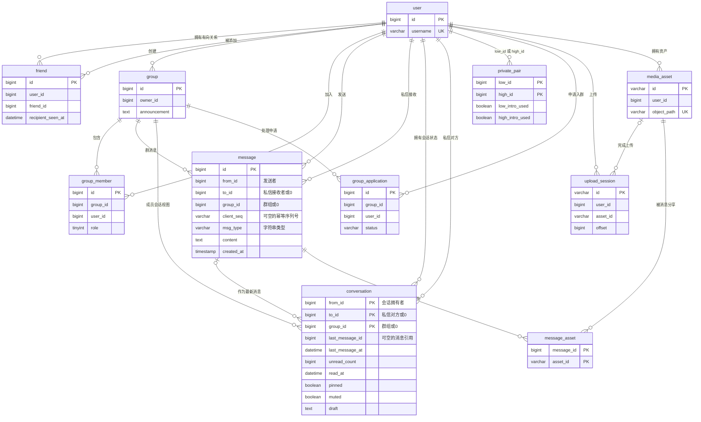

# 数据库设计文档

本文描述完成 006 迁移后的 MySQL 8.0 结构，以 [初始化脚本](../gochat/mysql/init.sql) 和 [迁移脚本](../gochat/mysql/migrations/) 为准。业务表使用 InnoDB 和 utf8mb4；目标数据库由配置指定，须预先创建。后端启动不会自动迁移。

## ER 图

图中连线表示逻辑引用。当前 SQL 未声明 `FOREIGN KEY`，关系校验、权限检查和相关写入由应用事务负责；字段名不代表数据库已建立外键约束。



迁移元数据和停止使用的历史表不参与业务 ER 图，见后文。

## 消息与会话的职责

`message` 保存一次发送的内容、目标、时间和幂等标识。MessageService 负责单条消息的校验、保存、查询和撤回；ConversationService 负责当前用户的会话列表、范围内的历史分页、最新消息摘要、偏好及已读/未读。MessagingService 在同一事务内保存消息并更新会话投影，提交成功后才确认发送和投递实时消息。

`conversation.from_id` 表示会话拥有者，`message.from_id` 表示消息发送者，两者不能混用。会话主键为 `(from_id, to_id, group_id)`，三个字段均非空：

| 视角 | from_id | to_id | group_id | 对外 scope |
| --- | --- | --- | --- | --- |
| A 的私信会话，对方 B | A | B | 0 | `private:B` |
| B 的私信会话，对方 A | B | A | 0 | `private:A` |
| A 在群 G 中的会话 | A | 0 | G | `group:G` |

scope 只在当前登录用户的视角中有效，拥有者由认证身份确定。一条私信被双方的会话引用，一条群消息被多个成员的会话引用，因此 `message` 不增加单一的 `conversation_id`。

## 表结构说明

### 1. `user` — 用户表

| 字段 | 类型 | 说明 |
| --- | --- | --- |
| id | BIGINT | 自增主键 |
| username | VARCHAR(32) | 用户名，非空且唯一 |
| password | VARCHAR(64) | bcrypt 密码摘要 |
| nickname | VARCHAR(64) | 昵称，默认空字符串 |
| avatar | VARCHAR(255) | 头像 URL，默认空字符串 |
| status | TINYINT | 0 离线、1 在线、2 忙碌，默认 0 |
| created_at | TIMESTAMP | 创建时间 |
| updated_at | TIMESTAMP | 更新时间 |

唯一索引：`username(username)`。其他索引：`idx_status(status)`、`idx_username(username)`。

### 2. `friend` — 有向好友关系表

| 字段 | 类型 | 说明 |
| --- | --- | --- |
| id | BIGINT | 自增主键 |
| user_id | BIGINT | 添加好友的一方 |
| friend_id | BIGINT | 被添加的一方 |
| remark | VARCHAR(64) | 个人备注，默认空字符串 |
| recipient_seen_at | DATETIME(3) | 接收方查看好友通知的时间，可空 |
| created_at | TIMESTAMP | 添加时间 |

唯一索引：`uk_user_friend(user_id, friend_id)`。其他索引：`idx_user(user_id)`、`idx_friend_recipient(friend_id)`。

A 添加 B 只创建 A → B 的关系，互加需要两条关系。好友通知的阅读状态与会话消息未读独立；添加好友本身不会创建空会话。

### 3. `group` — 群组表

| 字段 | 类型 | 说明 |
| --- | --- | --- |
| id | BIGINT | 自增主键 |
| name | VARCHAR(128) | 群名称 |
| avatar | VARCHAR(255) | 群头像 URL，默认空字符串 |
| owner_id | BIGINT | 群主用户 ID，角色修复时以此为准 |
| max_members | INT | 最大成员数，默认 500 |
| announcement | TEXT | 群公告，可空 |
| created_at | TIMESTAMP | 创建时间 |
| updated_at | TIMESTAMP | 更新时间 |

索引：`idx_owner(owner_id)`。

### 4. `group_member` — 群成员表

| 字段 | 类型 | 说明 |
| --- | --- | --- |
| id | BIGINT | 自增主键 |
| group_id | BIGINT | 群组 ID |
| user_id | BIGINT | 成员用户 ID |
| role | TINYINT | 0 普通成员、1 管理员、2 群主 |
| nickname | VARCHAR(128) | 群内昵称，默认空字符串 |
| muted_until | DATETIME(3) | 禁言截止时间，可空 |
| joined_at | TIMESTAMP | 加入时间 |
| last_read_message_id | BIGINT | 历史已读游标列，默认 0，当前应用不再读写 |
| read_at | DATETIME(3) | 历史成员阅读时间，可空，当前应用不再读写 |

唯一索引：`uk_group_user(group_id, user_id)`。其他索引：`idx_group(group_id)`、`idx_user(user_id)`。

当前阅读时间保存在 `conversation.read_at`。成员表保留上述两个历史列供迁移核对，不再承担群消息已读回执。

### 5. `message` — 消息表

| 字段 | 类型 | 说明 |
| --- | --- | --- |
| id | BIGINT | Snowflake 消息 ID，主键，不自增 |
| from_id | BIGINT | 消息发送者 ID |
| to_id | BIGINT | 私信接收者 ID；群消息为 0 |
| group_id | BIGINT | 群消息目标 ID；私信为 0 |
| client_seq | VARCHAR(128) | 发送方幂等序列号，可空 |
| msg_type | VARCHAR(20) | `text`、`image`、`file`、`voice`、`video`、`mention` |
| content | TEXT | 文本原文或多媒体 FileMeta JSON |
| is_revoked | TINYINT | 0 正常、1 已撤回，默认 0 |
| created_at | TIMESTAMP | 持久化发送时间，历史 SQL 定义为秒精度 |

唯一索引：`uk_message_sender_seq(from_id, client_seq)`。其他索引：`idx_from(from_id)`、`idx_to(to_id)`、`idx_group(group_id)`、`idx_created(created_at)`。

非空 `client_seq` 在同一发送者下唯一；重试返回已保存的消息，不重复增加会话未读。未提供幂等序列号时存为 NULL。最新消息按持久化的 `created_at`、`id` 排序，会话保存相同的消息时间；撤回后展示摘要和历史时清除内容。

### 6. `conversation` — 用户会话表

| 字段 | 类型 | 说明 |
| --- | --- | --- |
| from_id | BIGINT NOT NULL | 会话拥有者，联合主键成员 |
| to_id | BIGINT NOT NULL | 私信对方；群会话为 0，默认 0 |
| group_id | BIGINT NOT NULL | 群组 ID；私信会话为 0，默认 0 |
| last_message_id | BIGINT NULL | 最新消息引用，空会话为 NULL |
| last_message_at | DATETIME(3) NULL | 最新消息的持久化时间 |
| unread_count | BIGINT UNSIGNED NOT NULL | 当前未读数，默认 0 |
| read_at | DATETIME(3) NULL | 最近一次标记整个会话已读的时间 |
| pinned | BOOLEAN NOT NULL | 个人置顶，默认 FALSE |
| muted | BOOLEAN NOT NULL | 个人会话免打扰，默认 FALSE；与群成员禁言独立 |
| draft | TEXT NOT NULL | 个人草稿，创建时写入空字符串；接口限制 4096 UTF-8 字节 |
| created_at | DATETIME(3) NOT NULL | 创建时间，默认当前时间 |
| updated_at | DATETIME(3) NOT NULL | 状态更新时间，由应用更新 |

联合主键：`PRIMARY KEY(from_id, to_id, group_id)`。

| 索引/约束 | 字段或规则 |
| --- | --- |
| `idx_conversation_owner_latest` | `(from_id, pinned, last_message_at)`，用于拥有者的会话列表 |
| `idx_conversation_group` | `(group_id, from_id)`，用于群成员会话操作 |
| `chk_conversation_scope` | 私信：`from_id > 0 AND group_id = 0 AND to_id > 0 AND from_id <> to_id`；群聊：`from_id > 0 AND group_id > 0 AND to_id = 0` |

最新消息内容仍从 `message` 读取，会话只保存引用和时间。列表按置顶、最新消息时间（空会话回退到状态更新时间）等字段排序。私信展示名称与头像来自对方用户；群会话来自群组。

### 7. `private_pair` — 私信首次额度表

| 字段 | 类型 | 说明 |
| --- | --- | --- |
| low_id | BIGINT | 两个用户中较小的 ID，联合主键成员 |
| high_id | BIGINT | 两个用户中较大的 ID，联合主键成员 |
| low_intro_used | BOOLEAN | low → high 方向的首次文本额度是否已使用，默认 FALSE |
| high_intro_used | BOOLEAN | high → low 方向的首次文本额度是否已使用，默认 FALSE |

联合主键：`(low_id, high_id)`。应用规范化用户顺序并锁定此行，协调私信权限与额度写入。单向添加好友时仅允许首次文本，互加后正常发送；删除好友、重新添加或撤回消息不重置已使用的额度。该表不承担会话列表、阅读状态或偏好。

### 8. `group_application` — 入群申请表

| 字段 | 类型 | 说明 |
| --- | --- | --- |
| id | BIGINT | 自增主键 |
| group_id | BIGINT | 申请的群组 ID |
| user_id | BIGINT | 申请人 ID |
| group_name | VARCHAR(128) | 群名称快照 |
| status | VARCHAR(16) | `pending`、`approved`、`rejected`、`closed` |
| reason | VARCHAR(512) | 处理说明，默认空字符串 |
| handled_by | BIGINT | 处理人 ID，未处理时为 0 |
| created_at | DATETIME(3) | 申请时间 |
| handled_at | DATETIME(3) NULL | 处理时间 |

索引：`idx_application_group_status(group_id, status)`、`idx_application_user(user_id)`。待审核申请不授予群成员身份或历史访问权限。

### 9. `upload_session` — 持久化上传会话表

| 字段 | 类型 | 说明 |
| --- | --- | --- |
| id | VARCHAR(64) | 上传会话 ID，主键 |
| user_id | BIGINT | 上传者 ID |
| group_id | BIGINT | 群关联，默认 0 |
| name | VARCHAR(255) | 文件名 |
| type | VARCHAR(20) | 上传类型 |
| mime | VARCHAR(128) | MIME 类型 |
| size | BIGINT | 声明的总字节数 |
| offset | BIGINT | 已确认上传的字节数，默认 0 |
| temp_path | VARCHAR(1024) | 临时文件路径 |
| asset_id | VARCHAR(64) | 完成后的资产 ID，未完成时为空字符串 |
| expires_at | DATETIME(3) | 上传会话到期时间 |
| asset_expires_at | DATETIME(3) NULL | 预设的完成后资产到期时间 |
| created_at | DATETIME(3) | 创建时间 |

索引：`idx_session_expiry(expires_at)`、`idx_session_user(user_id)`。上传会话用于断点续传，与消息会话 `conversation` 是不同概念。

### 10. `media_asset` — 媒体资产表

| 字段 | 类型 | 说明 |
| --- | --- | --- |
| id | VARCHAR(64) | 资产 ID，主键 |
| user_id | BIGINT | 资产拥有者 ID |
| group_id | BIGINT | 群关联，默认 0 |
| object_path | VARCHAR(512) | 对象存储路径，唯一 |
| thumbnail_path | VARCHAR(512) | 缩略图路径，默认空字符串 |
| name | VARCHAR(255) | 文件名 |
| mime | VARCHAR(128) | MIME 类型 |
| size | BIGINT | 文件字节数 |
| width / height | INT | 媒体宽/高，默认 0 |
| duration | DOUBLE | 时长，默认 0 |
| expires_at | DATETIME(3) NULL | 资产到期时间，NULL 表示未设置到期 |
| created_at | DATETIME(3) | 创建时间 |

唯一索引：`uk_asset_path(object_path)`。其他索引：`idx_asset_group(group_id, created_at)`、`idx_asset_expiry(expires_at)`。文件内容保存在对象存储，数据库记录资产元数据。

### 11. `message_asset` — 消息附件引用表

| 字段 | 类型 | 说明 |
| --- | --- | --- |
| message_id | BIGINT | 消息 ID，联合主键成员 |
| asset_id | VARCHAR(64) | 已验证的资产 ID，联合主键成员 |

联合主键：`(message_id, asset_id)`。索引：`idx_message_asset(asset_id)`。附件分享引用与消息在同一事务中写入，供下载权限检查使用。

## 会话生命周期与已读/未读

发送私信时确保双方各有一条会话；发送群消息时确保所有当前成员各有一条群会话。更新每行的最新消息引用，接收方未读加一，发送方不增加未读。任一投影写入失败会回滚消息、附件引用及本次权限额度修改。

添加好友或加入没有历史消息的群不会自动创建空会话。显式打开会话会确保当前拥有者的记录，更新偏好也会确保该记录。加入已有历史消息的群会初始化最新消息引用，未读从 0 开始；已有偏好保留。

已读只通过 `POST /api/conversation/{scope}/read` 执行，无消息 ID 或游标。操作锁定当前用户的会话行，将 `unread_count` 清零并更新 `read_at`。已读提交后保存的新消息会重新增加未读。查询历史本身不会创建会话或清除未读；不提供单条消息已读、群成员回执或 WS 已读命令。

退出、被移除或群解散后，相关会话未读清零。列表和未读总数按群存在性及当前成员身份过滤，历史访问同步受成员权限限制；会话记录和个人偏好保留，重新加入时可复用。

当前接口契约见 [API 文档](api/README.md) 和 [OpenAPI](api/openapi.json)。

## 历史结构与迁移元数据

| 表/字段 | 迁移后的用途 |
| --- | --- |
| `unread_count` | 旧会话未读聚合，006 合并到 `conversation` 后停止运行时读写 |
| `conversation_preference` | 旧 `(user_id, scope)` 偏好，006 合并置顶、免打扰和草稿后停止运行时读写 |
| `group_member.last_read_message_id` / `read_at` | 旧群已读结构；006 合并阅读时间，当前应用不再读写这两个列 |
| `unread_count_legacy` | 从历史版本执行 001 时保留的原未读表；直接使用当前 `init.sql` 的新库不会生成该备份表 |
| `gochat_schema_migrations` | `im-migrate` 的版本记录，保存当前 `version` 和 `dirty` 失败标记 |

历史 `unread_count` 主键为 `(user_id, from_id, group_id)`，其中 `user_id` 才是拥有者，`from_id` 是私信对方（群聊固定为 0）。006 将该结构转换为会话主键，不能直接把旧 `from_id` 当作新表的拥有者。历史表与字段保留用于迁移核对，不与新表双写。

`send_policy`、`intro_remaining`、会话名称与头像等接口字段由相关表计算，不是 `conversation` 的存储列。

## 初始化、升级与修复

`im-migrate` 是独立部署步骤，SQL 通过 `go:embed` 打包，运行时无需外部 SQL 文件。默认配置为 `internal/config/config-dev.yaml`；命令仅校验 MySQL 配置，不要求 Redis、MinIO 或 JWT。

| 命令 | 行为 |
| --- | --- |
| `status` | 只读显示当前版本、dirty、待执行迁移及无记录旧库的候选基线，不创建版本表 |
| `up` | 空库初始化或按顺序升级至最新版本 6；重复执行最新版本成功退出 |
| `baseline -version N` | 仅为无版本记录的旧库登记 0–6 中的完整基线，不执行升级 SQL |
| `repair -version N` | 人工完成失败迁移后清除 dirty；N 必须等于失败版本，且结构检查通过 |

### 迁移顺序

| 版本 | 内容 |
| --- | --- |
| 0 | 历史基础结构，未读表仍使用 `count`，消息无 `client_seq` |
| 1 | 001：按会话聚合未读，保留 `unread_count_legacy` |
| 2 | 002：消息发送者/序列号唯一索引；当前 `init.sql` 已包含 001/002 的最终结构 |
| 3 | 003：旧会话偏好、上传会话、媒体资产及消息附件引用 |
| 4 | 004：群公告、成员昵称/禁言、历史群已读列，按群主修复角色和成员 |
| 5 | 005：好友通知阅读时间、私信首次额度及历史额度回填、入群申请 |
| 6 | 006：用户会话表，回填消息引用、未读、阅读时间及个人偏好 |

上述基线要求 `message.msg_type` 为字符串类型。早期仍使用数字消息类型的数据库，须先完成历史消息类型转换；不能直接登记为这些版本的基线。

空库执行 `up` 时先运行 `init.sql` 并登记版本 2，再依次执行 003–006。初始化前目标数据库须已创建，SQL 不包含硬编码的建库或 `USE gochat`。

Compose 新数据卷执行 `init.sql`、003、004、005、006，数据库名称由 `MYSQL_DATABASE` 指定；不生成迁移记录。确认已完成这些脚本及数据回填后，首次接入命令时登记基线 6。曾初始化到 005 的旧数据卷应登记实际基线 5，再执行 `up`；entrypoint 不会为已有数据卷自动补跑迁移。

### 执行示例

以下命令在仓库根目录执行，默认配置仅为示例；部署时使用目标环境的 MySQL 配置。

```powershell
# 先检查状态。空库可直接执行 up；已有版本记录时不执行 baseline。
go run ./cmd/im-migrate -config internal/config/config-dev.yaml status

# 仅用于确认已完成 001–005 且没有版本记录的旧库。
go run ./cmd/im-migrate -config internal/config/config-dev.yaml baseline -version 5

go run ./cmd/im-migrate -config internal/config/config-dev.yaml up
go run ./cmd/im-migrate -config internal/config/config-dev.yaml status
```

现有 Docker 镜像包含 `/app/im-migrate`，可使用服务挂载的配置执行：

```powershell
docker compose -f gochat/docker-compose.yaml run --rm --no-deps gochat-server ./im-migrate -config internal/config/config-dev.yaml status
docker compose -f gochat/docker-compose.yaml run --rm --no-deps gochat-server ./im-migrate -config internal/config/config-dev.yaml up
```

### 升级与失败处理

升级前备份数据库并验证恢复方式，停止旧应用写入。通过 `status` 核对实际完成的迁移；仅在无版本记录时登记基线，再执行 `up`，确认版本 6 且 `dirty: false` 后检查数据并启动新版本。

006 从历史私信构建双方视图，从群历史构建当前成员视图，并合并旧未读、成员阅读时间和个人偏好。显式打开过的空会话偏好也会保留。结构检查不能证明数据回填已完成，基线登记和修复需要操作者确认相应历史数据处理完整执行。

初始化与迁移执行前设置 dirty，成功后清除；失败后阻止继续升级和普通基线登记。初始化、基线、升级及修复使用迁移锁，但锁不会自动停止应用写入。迁移连接单独启用多语句执行，不修改应用连接配置。

MySQL DDL 可能已部分提交。失败时先读取失败版本，对照对应 SQL 人工补齐剩余结构和数据回填；不能直接重跑整个脚本或仅凭建表成功就清除 dirty。完成后执行 `repair -version N`，再执行 `up`。初始化失败对应 dirty 版本 2；006 失败对应 dirty 版本 6。

工具不提供自动回滚、`down` 或删除业务表。006 后旧应用仍会写入已经停用的旧未读/偏好结构，不能直接切回旧应用继续写入；需要回退时应先停写，并恢复迁移前备份或另行安排状态同步。
