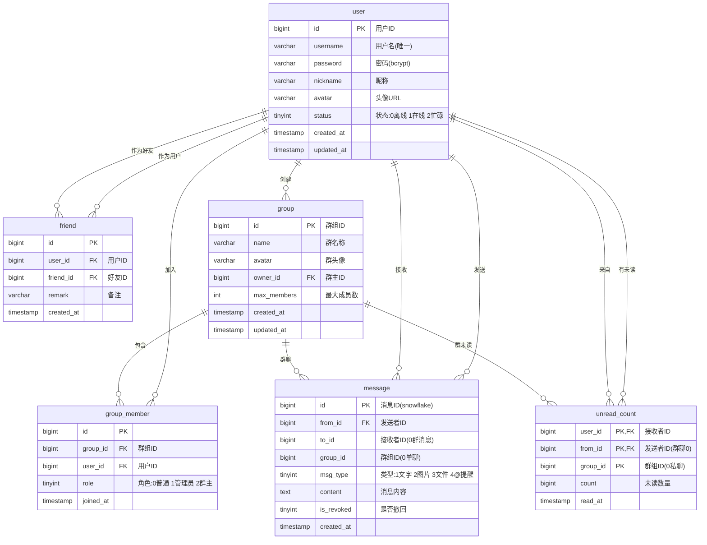

# 数据库设计文档

## ER 图



## 表结构说明

### 1. `user` — 用户表

| 字段 | 类型 | 说明 |
|------|------|------|
| id | BIGINT | 用户ID，主键自增 |
| username | VARCHAR(32) | 用户名，唯一索引 |
| password | VARCHAR(64) | bcrypt 加密密码 |
| nickname | VARCHAR(64) | 昵称 |
| avatar | VARCHAR(255) | 头像URL |
| status | TINYINT | 0离线 1在线 2忙碌 |
| created_at | TIMESTAMP | 创建时间 |
| updated_at | TIMESTAMP | 更新时间 |

索引: `idx_status`, `idx_username`

---

### 2. `friend` — 好友关系表

| 字段 | 类型 | 说明 |
|------|------|------|
| id | BIGINT | 主键自增 |
| user_id | BIGINT | 用户ID |
| friend_id | BIGINT | 好友ID |
| remark | VARCHAR(64) | 好友备注 |
| created_at | TIMESTAMP | 添加时间 |

唯一约束: `uk_user_friend(user_id, friend_id)`  
索引: `idx_user`

---

### 3. `group` — 群组表

| 字段 | 类型 | 说明 |
|------|------|------|
| id | BIGINT | 群组ID，主键自增 |
| name | VARCHAR(128) | 群名称 |
| avatar | VARCHAR(255) | 群头像 |
| owner_id | BIGINT | 群主ID |
| max_members | INT | 最大成员数，默认500 |
| created_at | TIMESTAMP | 创建时间 |
| updated_at | TIMESTAMP | 更新时间 |

索引: `idx_owner`

---

### 4. `group_member` — 群成员表

| 字段 | 类型 | 说明 |
|------|------|------|
| id | BIGINT | 主键自增 |
| group_id | BIGINT | 群组ID |
| user_id | BIGINT | 用户ID |
| role | TINYINT | 0普通 1管理员 2群主 |
| joined_at | TIMESTAMP | 加入时间 |

唯一约束: `uk_group_user(group_id, user_id)`  
索引: `idx_group`, `idx_user`

---

### 5. `message` — 消息表

| 字段 | 类型 | 说明 |
|------|------|------|
| id | BIGINT | 消息ID(snowflake生成) |
| from_id | BIGINT | 发送者ID |
| to_id | BIGINT | 接收者ID(0表示群消息) |
| group_id | BIGINT | 群组ID(0表示单聊) |
| msg_type | TINYINT | 1文字 2图片 3文件 4@提醒 |
| content | TEXT | 消息内容 |
| is_revoked | TINYINT | 0正常 1已撤回 |
| created_at | TIMESTAMP | 发送时间 |

索引: `idx_from`, `idx_to`, `idx_group`, `idx_created`

---

### 6. `unread_count` — 未读计数表

| 字段 | 类型 | 说明 |
|------|------|------|
| user_id | BIGINT | 接收者ID |
| from_id | BIGINT | 发送者ID(群聊时为0) |
| group_id | BIGINT | 群组ID(0表示私聊) |
| count | BIGINT | 未读数量 |
| read_at | TIMESTAMP | 最后阅读时间 |

主键: `(user_id, from_id, group_id)`  
索引: `idx_user`

---

## 核心业务关系

```
用户 ── 好友关系 ── 其他用户
  │
  ├── 创建群组 ── 群组 ── 群成员 ── 其他用户
  │
  ├── 发送消息 ── 消息 ── 接收者/群组
  │
  └── 未读计数 ── 用户/群维度聚合
```

- **私聊**: `message.to_id != 0` 且 `message.group_id = 0`
- **群聊**: `message.group_id != 0` 且 `message.to_id = 0`
- **未读**: 按 `(user_id, from_id, group_id)` 聚合计数，读取时清零
