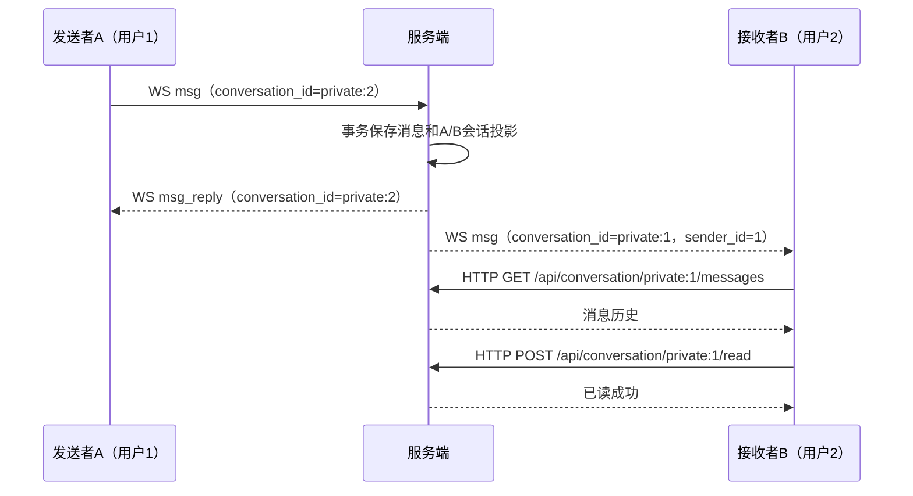
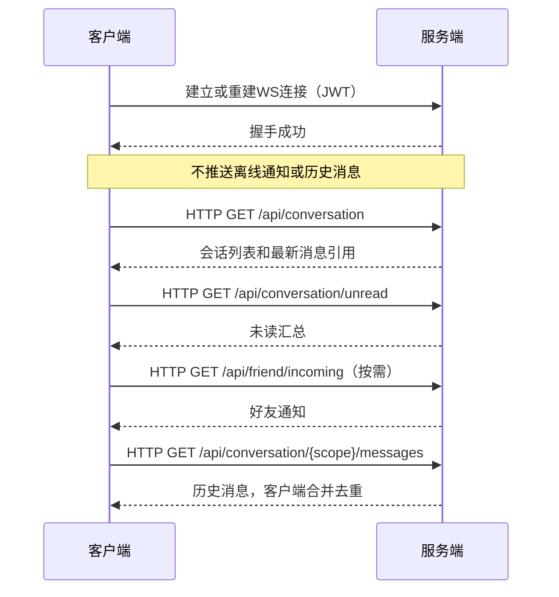

# WebSocket 协议文档

本文定义当前 WS 协议：取消连接时的离线通知推送，由客户端主动通过 HTTP 获取持久化通知与会话状态；聊天数据使用 `conversation_id` 定位会话。

后端、SDK、前端和接入示例使用下述会话标识协议。当前 HTTP 接口契约见 [API 文档](api/README.md) 和 [OpenAPI](api/openapi.json)。

## 连接与认证

WebSocket 使用 `server.connect_addr` 监听器，端点为 `/ws`。

支持在握手时使用 `Authorization: Bearer <JWT>`；浏览器原生 WebSocket 无法设置该请求头，可使用 `/ws?token=<JWT>`。生产环境使用 `wss`。缺失或无效的 Token 在升级前返回 HTTP 401；升级成功后，用户身份由该连接的认证结果确定，不需要再发送 `auth` 命令。

同一用户建立新连接时替换旧连接。连接建立后只建立实时消息通道，不自动查询或推送未读汇总，客户端随后主动拉取状态。

## 通用消息结构

所有业务帧均为 JSON 文本，使用以下结构：

```json
{
  "cmd": "msg",
  "seq": "2bb7c612-7f51-4a31-938e-219154735b1b",
  "data": {
    "conversation_id": "private:2",
    "type": "text",
    "content": "你好"
  }
}
```

| 字段 | 类型 | 说明 |
| --- | --- | --- |
| `cmd` | string | 命令或事件名称 |
| `seq` | string | 请求响应匹配与发送幂等序列号；没有请求关联时使用空字符串 |
| `data` | object / null | 对应命令的数据，心跳可省略或为 null |

每条新消息生成独立的 `seq`，推荐 UUID，最长 128 字节。重试同一条消息必须保留原 `seq`、会话目标和内容；不要仅使用可能重复的毫秒时间戳。相同发送者复用 `seq` 时，会话或消息类型/内容与原请求不同将被拒绝。

上行命令为 `ping`、`msg`。下行事件为 `pong`、`msg_reply`、`msg`、`error`，以及已有的关系变更提示 `friend_changed`、`group_changed`。不提供 WS 已读命令或离线通知事件。

## 会话标识 `conversation_id`

`conversation_id` 是当前登录用户视角中的会话标识，沿用 HTTP scope 格式，作为聊天数据中唯一的会话寻址字段：

| 类型 | 格式 | 示例 |
| --- | --- | --- |
| 私信 | `private:<对方用户ID>` | `private:2` |
| 群聊 | `group:<群组ID>` | `group:10` |

冒号后的 ID 为正的 int64 十进制文本，不使用前导零、负数或科学计数法。私信对方不能是当前用户；群会话要求当前用户具有有效成员身份，发送时还须通过禁言检查。

`conversation_id` 替换聊天数据中的 `from_id`、`to_id`、`group_id`。发送者身份从认证连接获取，私信接收者或群组从 `conversation_id` 解析，不接受客户端声明的发送者身份。

私信转发时必须转换为接收者视角：

| 场景 | 登录用户 | conversation_id |
| --- | --- | --- |
| A（用户 1）向 B（用户 2）发送 | A | `private:2` |
| A 收到发送确认 | A | `private:2` |
| B 收到该私信 | B | `private:1` |
| A 向群 10 发送、成员收到群消息 | 各自的登录用户 | `group:10` |

它不是全局共享的数据库单列主键。数据库中仍使用 `(from_id, to_id, group_id)` 标识拥有者的会话记录，详见 [数据库文档](database.md)。聊天协议字段替换不改变数据库消息表的发送者与目标列。

下行消息另带 `sender_id` 表示消息作者，尤其用于区分群成员。它不参与会话寻址：`conversation_id` 决定消息归属的会话，`sender_id` 决定作者。该字段由服务端填充，采用十进制字符串保留 int64 精度。

## 客户端 → 服务端

### `ping` — 心跳

客户端可每 30 秒发送 JSON 心跳，检测业务通道是否可用：

```json
{ "cmd": "ping", "seq": "", "data": null }
```

服务端返回 `pong`。JSON 心跳与 WebSocket 协议层的 Ping/Pong 控制帧独立。

### `msg` — 发送消息

私信和群聊使用相同的数据结构，仅 `conversation_id` 不同：

```json
{
  "cmd": "msg",
  "seq": "2bb7c612-7f51-4a31-938e-219154735b1b",
  "data": {
    "conversation_id": "private:2",
    "type": "text",
    "content": "你好"
  }
}
```

```json
{
  "cmd": "msg",
  "seq": "e1080d4b-ab48-420c-9d93-cd92f5b5f52",
  "data": {
    "conversation_id": "group:10",
    "type": "text",
    "content": "大家好"
  }
}
```

| data 字段 | 类型 | 说明 |
| --- | --- | --- |
| `conversation_id` | string | 当前发送者视角中的私信或群会话标识，必填 |
| `type` | string | `text`、`image`、`file`、`voice`、`video`、`mention` |
| `content` | string | 文本原文；多媒体为编码成字符串的 FileMeta JSON，不能为空或仅含空白 |

私信发送权限与首次文本额度由服务端检查。群发送要求当前成员身份且未被禁言，持久化事务中再次检查权限。附件引用须通过资产权限校验。

服务端在一个事务内保存消息、附件引用并更新当前成员或私信双方的会话投影。事务成功后向发送者返回 `msg_reply`，再将消息投递给在线接收者；持久化失败返回 `error`。

## 服务端 → 客户端

### `pong` — 心跳响应

```json
{ "cmd": "pong", "seq": "", "data": null }
```

### `msg_reply` — 消息发送确认

```json
{
  "cmd": "msg_reply",
  "seq": "2bb7c612-7f51-4a31-938e-219154735b1b",
  "data": {
    "status": "success",
    "conversation_id": "private:2",
    "message_id": 321622086873387008,
    "message_id_string": "321622086873387008",
    "duplicate": false
  }
}
```

| data 字段 | 类型 | 说明 |
| --- | --- | --- |
| `status` | string | 保存成功时为 `success` |
| `conversation_id` | string | 已保存消息对应的发送者视角会话标识 |
| `message_id` | integer | 消息 ID，保留数字形式兼容现有 ACK 解码 |
| `message_id_string` | string | 消息 ID 的精确十进制文本，JavaScript 应使用此字段 |
| `duplicate` | boolean | 幂等重试命中已有消息时为 true |

`seq` 与原发送请求相同。同一发送者使用相同的非空 `seq` 重试时，返回原消息 ID，不重复保存、增加未读或转发。未设置 `seq` 时不提供基于序列号的幂等保证。

ACK 表示消息和会话状态已持久化，不表示接收者在线、投递成功或已经阅读。断线后需要重试时由客户端保留原始请求；重连本身不代表服务端会重放未确认请求。

### `msg` — 实时消息转发

B 收到 A 的私信时使用 B 的会话标识：

```json
{
  "cmd": "msg",
  "seq": "2bb7c612-7f51-4a31-938e-219154735b1b",
  "data": {
    "id": "321622086873387008",
    "conversation_id": "private:1",
    "sender_id": "1",
    "type": "text",
    "content": "你好",
    "created_at": "2026-10-12T12:00:00Z"
  }
}
```

群消息示例：

```json
{
  "cmd": "msg",
  "seq": "e1080d4b-ab48-420c-9d93-cd92f5b5f52",
  "data": {
    "id": "321622086873387009",
    "conversation_id": "group:10",
    "sender_id": "1",
    "type": "text",
    "content": "大家好",
    "created_at": "2026-10-12T12:00:01Z"
  }
}
```

| data 字段 | 类型 | 说明 |
| --- | --- | --- |
| `id` | string | 已持久化消息的十进制 ID，客户端据此合并和去重 |
| `conversation_id` | string | 接收者视角中的会话标识 |
| `sender_id` | string | 经认证确认的作者用户 ID；群消息中区分发送成员 |
| `type` | string | 消息类型 |
| `content` | string | 文本或 FileMeta JSON 字符串 |
| `created_at` | string | 已持久化发送时间，RFC 3339 格式 |

转发保留原发送请求的 `seq`；如果原请求没有序列号，则为空字符串。接收者不得只按 `seq` 去重，不同发送者可能使用相同序列号，应以消息 `id` 为准。

群消息投递给本次事务确定的在线接收成员，排除发送者。离线或实时投递失败时，消息和未读仍保存在数据库，客户端通过 HTTP 恢复状态；服务端不以连接后的离线推送补发汇总或历史消息。

### `friend_changed` / `group_changed` — 关系变更提示

保留现有在线关系变更事件，作为客户端重新查询 HTTP 状态的提示。收到 `friend_changed` 时可刷新好友关系及收到的好友通知；收到 `group_changed` 时可刷新群组、入群申请和会话列表。提示不携带完整通知列表，也不替代主动获取；断线期间遗漏的变化通过重新查询恢复。

这些是关系变更事件，其现有数据格式见 [API 文档](api/README.md)。聊天数据的 `conversation_id` 替换范围为 `msg` 及其确认，不改动关系事件或 HTTP 返回结构。

### `error` — 错误响应

```json
{
  "cmd": "error",
  "seq": "2bb7c612-7f51-4a31-938e-219154735b1b",
  "data": {
    "code": 49001,
    "message": "无效的会话标识"
  }
}
```

`seq` 在可关联请求时回传。WS 错误使用上述帧格式，不在 `data` 内再包一层 HTTP 的 `{code, message, data}`。

| code | 名称 | 说明 |
| --- | --- | --- |
| 49001 | CodeWsInvalidMsg | 消息格式或会话标识无效 |
| 49002 | CodeWsSendFailed | 消息发送失败 |
| 49004 | CodeWsNotFound | 消息不存在 |
| 49005 | CodeWsOffline | 用户不在线 |
| 49006 | CodeWsQueueFull | 发送队列已满 |
| 42010 | CodePrivateFriendRequired | 发送私信前须添加对方为好友 |
| 42011 | CodePrivateTextOnly | 互加好友前仅允许首次文本 |
| 42012 | CodePrivateIntroUsed | 首次文本额度已使用 |

群成员权限、禁言或附件权限失败也可能返回发送失败。握手认证失败属于 HTTP 401，不是升级后的 WS `error`。无法解析的 JSON、未注册命令或超出频率限制的帧可能被忽略，不保证每个无效帧均收到错误响应。

## 客户端主动获取通知与状态

取消 `offline_notify`，不新增替代的 WS 拉取通知命令。客户端通过现有 HTTP 接口主动获取持久化状态，并携带 `Authorization: Bearer <JWT>`：

| 获取内容 | HTTP 接口 | 用途 |
| --- | --- | --- |
| 会话列表 | `GET /api/conversation?limit=100&offset=0` | 获取最新消息引用、个人偏好和每个会话的未读；按页加载完整列表 |
| 消息未读汇总 | `GET /api/conversation/unread` | 获取未读总数及按会话聚合的列表，条目 `id` 与 conversation_id 使用相同格式 |
| 会话历史 | `GET /api/conversation/{scope}/messages?limit=50&offset=0` | 恢复实时通道遗漏的消息，按消息 ID 合并缓存 |
| 收到的好友通知 | `GET /api/friend/incoming` | 获取他人添加自己的通知及其阅读状态 |
| 自己的入群申请 | `GET /api/group/applications/mine` | 获取申请审核状态 |
| 群内入群申请 | `GET /api/group/{groupId}/applications` | 在具备相应管理权限时获取申请列表 |

这里的 `{scope}` 直接使用当前用户的 `conversation_id`。HTTP 返回结构保持现有契约，不把 HTTP 中的历史消息、通知作者或兼容字段一并改为 WS 聊天字段。

主动获取时机：

1. 登录并建立 WS 后，加载会话列表、未读汇总及需要展示的关系通知。
2. 每次重连成功后再次查询，不等待服务端推送离线汇总。
3. 页面恢复到前台、用户主动刷新或收到关系变更提示时，刷新相应 HTTP 状态。
4. 打开会话时获取历史；客户端确认该会话仍可见且历史加载成功后，主动标记已读。

拉取期间收到的实时消息应按消息 ID 合并。会话快照加载中发生新事件时，应记录刷新需求并在请求结束后重新拉取，避免旧快照覆盖新未读状态，也避免把已包含在汇总中的消息重复计数。

查询会话、历史和通知不会自动清除阅读状态。消息会话已读使用 `POST /api/conversation/{scope}/read`，无请求体；清除当前整个会话的未读并设置 `read_at`，提交后保存的新消息继续产生未读。好友通知的阅读确认使用其独立 HTTP 接口。客户端在已读请求失败时保留未读状态。

## 通信时序

### 私信发送与阅读



### 重连后主动恢复状态



## 传输限制与协议切换

沿用当前传输限制：单个入站 WS 帧最多 4096 字节，每连接超过每秒 30 帧的流量会被丢弃。`content` 为多媒体 JSON 字符串时，整个外层帧仍受该大小限制；二进制文件经 HTTP 上传，WS 仅发送资产引用。

服务端每 54 秒发送协议层 Ping，使用 90 秒读超时并由协议层 Pong 续期；写超时为 10 秒。客户端应保持控制帧处理，同时可使用 JSON `ping/pong` 检测业务通道。断开后停止心跳，重连成功后恢复心跳并主动加载 HTTP 状态。

这是一次聊天数据格式变更：上行和下行 `msg` 移除 `from_id/to_id/group_id`，增加 `conversation_id`，下行增加服务端填充的 `sender_id`；`msg_reply` 增加发送者视角的 `conversation_id`；连接时移除 `offline_notify`。升级时需要同步更新服务端、SDK、前端和接入示例；仅发送旧寻址字段的聊天请求会被拒绝。数据库表结构及既有 HTTP 接口不因本次 WS 字段替换而变化。
